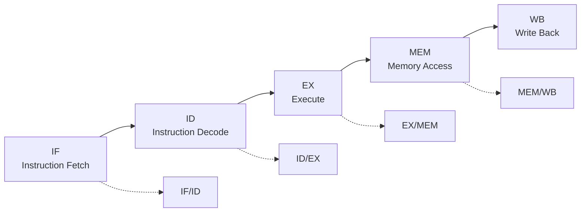
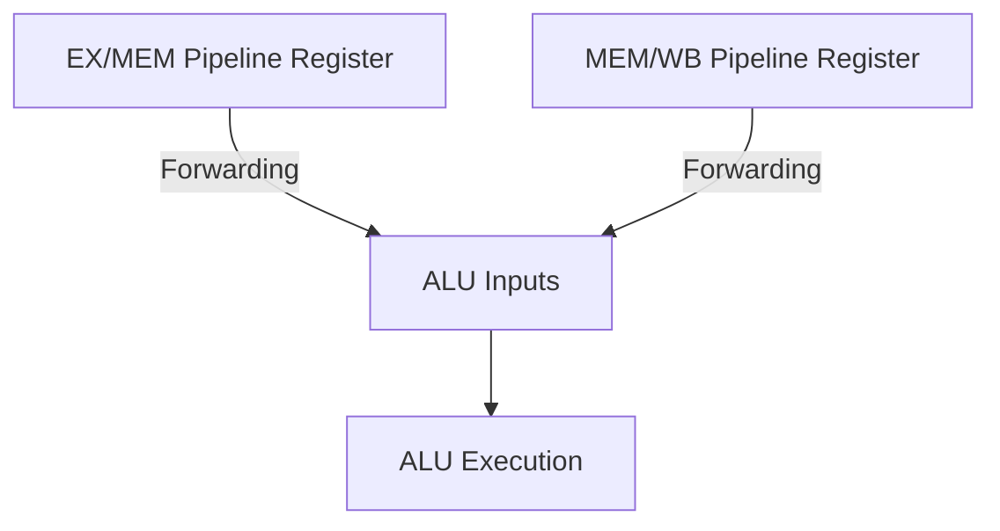
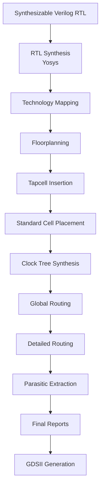

# MIPS32 Five-Stage Pipelined Processor

### A 32-bit Pipelined Processor Designed Using Verilog-2001 and Implemented Through the RTL-to-GDSII Flow

<p align="center">

**RTL Design** · **Computer Architecture** · **Digital Design** · **VLSI Physical Design**

</p>

<p align="center">


</p>

---

## 📌 Project Overview

This project presents the design and physical implementation of a **32-bit, five-stage pipelined MIPS processor** using synthesizable Verilog-2001.

The processor follows a modular architecture consisting of independent RTL components for instruction fetching, instruction decoding, execution, memory access, and write-back.

It incorporates essential pipeline mechanisms such as:

- Data forwarding and dependency resolution.
- Load-use hazard detection and pipeline stalling.
- Branch and jump handling with pipeline flushing.
- Separate instruction and data memories.
- Pipeline registers with valid-bit management.

The project goes beyond RTL development and functional simulation. The processor was synthesised using **Yosys**, physically implemented using **OpenROAD**, and taken through the RTL-to-GDSII flow using the **SKY130HD standard-cell library**.

<details>
<summary><strong>Project at a glance</strong></summary>

| Attribute | Description |
|---|---|
| Processor architecture | MIPS32 |
| Data width | 32-bit |
| Pipeline | Five stages |
| RTL language | Verilog-2001 |
| Design style | Modular RTL |
| Simulation | Icarus Verilog |
| Synthesis | Yosys |
| Physical design | OpenROAD |
| Technology | SKY130HD |
| Final output | GDSII layout |
| Top module | `mips32_pipeline` |

</details>

---

## 📚 Table of Contents

| No. | Section |
|:---:|---|
| 01 | [Architecture and Pipeline Organisation](#-1-architecture-and-pipeline-organisation) |
| 02 | [Supported Instruction Set](#-2-supported-instruction-set) |
| 03 | [Hazard Detection and Resolution](#-3-hazard-detection-and-resolution) |
| 04 | [RTL Module Organisation](#-4-rtl-module-organisation) |
| 05 | [Instruction Memory and Program Modification](#-5-instruction-memory-and-program-modification) |
| 06 | [Simulation and Verification](#-6-simulation-and-verification) |
| 07 | [Synthesis](#-7-synthesis) |
| 08 | [RTL-to-GDSII Physical Design](#-8-rtl-to-gdsii-physical-design-flow) |
| 09 | [Implementation Results](#-9-physical-implementation-results) |
| 10 | [Tools and Technologies](#-10-tools-and-technologies) |
| 11 | [Repository Structure](#-11-repository-structure) |
| 12 | [Getting Started](#-12-getting-started) |
| 13 | [Design Considerations](#-13-design-considerations) |
| 14 | [Future Improvements](#-14-future-improvements) |
| 15 | [Project Status](#-15-project-status) |

---

## 🧠 1. Architecture and Pipeline Organisation

The processor implements a classical five-stage pipeline. Each instruction progresses through five distinct stages, allowing multiple instructions to be processed simultaneously.

### Five Pipeline Stages

| Stage | Name | Function |
|:---:|---|---|
| **IF** | Instruction Fetch | Fetches the instruction from instruction memory and updates the program counter. |
| **ID** | Instruction Decode | Decodes the instruction, generates control signals, and reads source registers. |
| **EX** | Execute | Performs ALU operations, calculates memory addresses, and resolves branch/jump decisions. |
| **MEM** | Memory Access | Performs data memory read and write operations. |
| **WB** | Write Back | Selects and writes the result into the register file. |

### Pipeline Flow



### Pipeline Registers

The pipeline stages are separated by four pipeline registers:

| Pipeline Register | Purpose |
|---|---|
| IF/ID | Stores the fetched instruction and associated PC information. |
| ID/EX | Carries decoded control signals, operands, and instruction information. |
| EX/MEM | Stores ALU results, memory control signals, and destination information. |
| MEM/WB | Carries memory and execution results for write-back. |

---

## ⚙️ 2. Supported Instruction Set

The current implementation supports a selected subset of the MIPS instruction set.

| Instruction | Operation | Instruction Type |
|---|---|---|
| `ADD` | Register addition | R-type |
| `SUB` | Register subtraction | R-type |
| `AND` | Bitwise AND | R-type |
| `OR` | Bitwise OR | R-type |
| `XOR` | Bitwise XOR | R-type |
| `SLT` | Set on less than | R-type |
| `ADDI` | Immediate addition | I-type |
| `LW` | Load word from memory | I-type |
| `SW` | Store word into memory | I-type |
| `BEQ` | Branch if equal | I-type |
| `BNE` | Branch if not equal | I-type |
| `J` | Unconditional jump | J-type |

> **Note:** This project implements a defined MIPS instruction subset, not the complete MIPS32 instruction-set architecture.

---

## 🔄 3. Hazard Detection and Resolution

Pipeline hazards occur when instructions executing simultaneously depend on one another or alter the normal flow of execution.

This implementation handles the main data and control hazards using forwarding, stalling, and flushing.

### 3.1 Data Forwarding

The forwarding unit detects dependencies between the instruction in the EX stage and instructions in earlier pipeline stages.

Implemented forwarding paths:



- EX/MEM → EX
- MEM/WB → EX

This reduces unnecessary stalls caused by data dependencies.

### 3.2 Load-Use Hazard Detection

A load-use hazard occurs when an instruction requires data from a preceding load instruction before the loaded value is available.

The hazard detection unit identifies this condition and inserts a **one-cycle stall**.

### 3.3 Branch and Jump Handling

Branch and jump decisions are resolved in the EX stage.

When a branch is taken or a jump is executed, younger instructions already in the pipeline are flushed to prevent incorrect execution.

The processor does not implement a branch delay slot.

### 3.4 Pipeline Valid Bits

Valid bits indicate whether pipeline stages contain meaningful instructions.

They help control the flow of instructions during stalls and pipeline flushing.

---

## 🧩 4. RTL Module Organisation

The processor is implemented using independent Verilog modules, with `mips32_pipeline` serving as the top-level module.

### Main RTL Components

| Module | Responsibility |
|---|---|
| `mips32_pipeline.v` | Top-level processor integration |
| `program_counter.v` | Program counter management |
| `pc_adder.v` | Sequential PC calculation |
| `instruction_memory.v` | Instruction ROM |
| `register_file.v` | 32 × 32-bit register file |
| `control_unit.v` | Instruction decoding and control generation |
| `alu_control.v` | ALU operation selection |
| `alu.v` | Arithmetic and logical operations |
| `alu_input_mux.v` | ALU operand selection |
| `sign_extend.v` | Immediate sign extension |
| `destination_register.v` | Destination register selection |
| `branch_jump_unit.v` | Branch and jump control |
| `forwarding_unit.v` | Data forwarding control |
| `hazard_detection_unit.v` | Load-use hazard detection |
| `data_memory.v` | Data memory |
| `if_id.v` | IF/ID pipeline register |
| `id_ex.v` | ID/EX pipeline register |
| `ex_mem.v` | EX/MEM pipeline register |
| `mem_wb.v` | MEM/WB pipeline register |
| `writeback_mux.v` | Write-back data selection |

---

## 💾 5. Instruction Memory and Program Modification

The instruction memory is implemented as a synthesizable ROM using a Verilog `case` statement rather than relying directly on `$readmemh` during synthesis.

A Python utility generates the ROM from an external memory file.

**Program source:**

` scripts/program.mem `

**ROM generator:**

` scripts/hex2rom.py `

### How to change the processor program

**Step 1:** Edit the instruction sequence in:

```text
scripts/program.mem
```

**Step 2:** Generate the Verilog ROM:

```bash
python3 scripts/hex2rom.py scripts/program.mem rtl/instruction_memory.v
```

**Step 3:** Re-run simulation and synthesis checks.

This keeps the instruction program separate from the processor's main RTL implementation.

---

## 🧪 6. Simulation and Verification

The processor is verified using a dedicated integration testbench.

**Testbench location:**

`tb/tb_mips32_synth.v`

The synthesis-oriented testbench is derived from the earlier integration testbench, with direct instruction-memory and data-memory testbench pokes removed. The program is supplied through the generated instruction ROM.

### Verification Coverage

- Arithmetic and logical operations.
- Data forwarding.
- Load and store operations.
- Load-use hazard detection.
- One-cycle pipeline stall.
- Branch not taken.
- BNE branch taken.
- Jump handling.
- Pipeline flushing.

### Simulation Results

| Verification Metric | Result |
|---|---:|
| Total passing tests | **17** |
| Total failing tests | **0** |
| Load-use stall count | **1** |
| Overall result | **ALL TESTS PASSED** |

```text
=================================
       MIPS32 VERIFICATION
=================================

TOTAL PASS : 17
TOTAL FAIL : 0
STALL COUNT: 1

FINAL RESULT: ALL INTEGRATION TESTS PASSED

=================================
```

These results demonstrate successful integration testing of the implemented instruction subset and pipeline control mechanisms. They do not constitute exhaustive formal verification.

---

## 🔬 7. Synthesis

The RTL design is synthesised and structurally checked using **Yosys**, an open-source RTL synthesis framework.

### Synthesis Check

The project includes a dedicated synthesis validation script:

```text
scripts/check_synth.sh
```

Execute it using:

```bash
chmod +x scripts/check_synth.sh
./scripts/check_synth.sh
```

**Result:**

```text
SYNTH CHECK PASSED
```

The design was also mapped to the SKY130HD standard-cell library for physical implementation.

---

## 🏗️ 8. RTL-to-GDSII Physical Design Flow

One of the major objectives of this project was to take the synthesizable processor RTL through a complete physical implementation flow.

The implementation was carried out using **OpenROAD Flow Scripts (ORFS)** with the SKY130HD platform.

### Physical Design Flow



### Implementation Stages

| Stage | Description |
|---|---|
| RTL Synthesis | Converts Verilog RTL into a gate-level netlist. |
| Technology Mapping | Maps logic to SKY130HD standard cells. |
| Floorplanning | Defines the physical core and placement region. |
| Placement | Places standard cells within the core. |
| Clock Tree Synthesis | Builds the clock distribution network. |
| Global Routing | Estimates routing paths and resource usage. |
| Detailed Routing | Creates detailed interconnects using metal layers and vias. |
| Parasitic Extraction | Extracts resistance and capacitance information. |
| GDSII Generation | Produces the final physical layout database. |

---

## 📊 9. Physical Implementation Results

The following results were obtained from the completed SKY130HD implementation run.

### 9.1 Synthesis Statistics

| Parameter | Result |
|---|---:|
| Mapped standard cells | 19,860 |
| Mapped cell area | 391,446.68 µm² |
| Sequential cell area | 286,435.96 µm² |
| Sequential area percentage | 73.17% |

### 9.2 Clock and Timing Results

| Parameter | Result |
|---|---:|
| Clock period specified in SDC | 15 ns |
| CTS worst slack | +3.24 ns |
| CTS minimum clock period estimate | 11.76 ns |
| CTS estimated maximum frequency | 85.06 MHz |
| CTS setup/hold violations | 0 |
| Global-route congestion overflow | 0 |

The estimated maximum frequency is derived from the CTS timing report. It is not a measured silicon operating frequency.

### 9.3 Detailed Routing Results

| Parameter | Result |
|---|---:|
| Detailed routed wirelength | 1,255,174 µm |
| Total vias | 204,436 |
| Final detailed-route DRC count | 0 |
| Antenna net violations | 0 |
| Antenna pin violations | 0 |
| Filler cells inserted | 97,668 |

### 9.4 Final Physical Design

| Parameter | Result |
|---|---:|
| Final reported design area | 449,978 µm² |
| Final reported utilization | 40% |
| Final GDSII file | `6_final.gds` |
| GDSII file size | Approximately 39 MB |

> **Physical verification note:** The zero detailed-routing DRC and antenna violations are results reported by the OpenROAD implementation flow. Independent final signoff DRC and LVS verification have not yet been completed. The design should not be described as foundry-signoff clean.

---

## 🛠️ 10. Tools and Technologies

| Tool / Technology | Application |
|---|---|
| Verilog-2001 | RTL design |
| Icarus Verilog | Functional simulation |
| Yosys | RTL synthesis |
| OpenROAD | Physical implementation |
| OpenROAD Flow Scripts | Automated RTL-to-GDSII flow |
| SKY130HD | Standard-cell technology |
| KLayout | GDSII layout inspection |
| Python 3 | Instruction ROM generation |
| Git | Version control |
| GitHub | Source-code hosting |

---

## 📁 11. Repository Structure

```text
MIPS32-Pipelined-Processor/
│
├── rtl/
│   ├── alu.v
│   ├── alu_control.v
│   ├── alu_input_mux.v
│   ├── branch_jump_unit.v
│   ├── control_unit.v
│   ├── data_memory.v
│   ├── destination_register.v
│   ├── ex_mem.v
│   ├── forwarding_unit.v
│   ├── hazard_detection_unit.v
│   ├── id_ex.v
│   ├── if_id.v
│   ├── instruction_memory.v
│   ├── mem_wb.v
│   ├── mips32_pipeline.v
│   ├── pc_adder.v
│   ├── program_counter.v
│   ├── register_file.v
│   ├── sign_extend.v
│   └── writeback_mux.v
│
├── tb/
│   └── tb_mips32_synth.v
│
├── scripts/
│   ├── check_synth.sh
│   ├── hex2rom.py
│   └── program.mem
│
├── backend/
│   ├── config.mk
│   └── constraint.sdc
│
├── .gitignore
└── README.md
```

---

## 🚀 12. Getting Started

### Prerequisites

Install or configure the following tools:

- Git
- Python 3
- Icarus Verilog
- Yosys
- OpenROAD and OpenROAD Flow Scripts
- SKY130HD platform files

### Step 1: Clone the Repository

```bash
git clone https://github.com/rahul-wrc/MIPS32-Pipelined-Processor.git
```

```bash
cd MIPS32-Pipelined-Processor
```

### Step 2: Generate Instruction ROM

```bash
python3 scripts/hex2rom.py scripts/program.mem rtl/instruction_memory.v
```

### Step 3: Run Synthesis Check

```bash
chmod +x scripts/check_synth.sh
./scripts/check_synth.sh
```

### Step 4: Run Simulation

Using Icarus Verilog:

```bash
iverilog -g2012 -s tb_mips32_synth -o sim.out rtl/*.v tb/tb_mips32_synth.v
```

Run the simulation:

```bash
vvp sim.out
```

The generated instruction ROM must correspond to the program being tested.

### Step 5: Physical Implementation

The physical-design configuration files are provided under:

```text
backend/
```

The OpenROAD Flow Scripts environment and SKY130HD platform must be installed and configured separately before running the physical implementation flow.

---

## 📝 13. Design Considerations

Several implementation decisions were made to improve synthesis compatibility and physical implementation.

- **Instruction memory:** Implemented as a synthesizable `case`-based ROM generated from an external memory file.
- **Register file:** Uses an explicit flip-flop-bank implementation.
- **Data memory:** Uses an explicit flip-flop-bank implementation rather than an asynchronous-reset memory array.
- **Memory reset optimisation:** Data memory storage bits are not individually reset. Valid bits are reset, and invalid locations read as zero.
- **Pipeline control:** Pipeline valid signals are declared before their first use in the top-level module.
- **RTL compatibility:** The implementation uses modular Verilog-2001 constructs suitable for the selected synthesis flow.

These implementation changes preserve the top-level module interface.

---

## 🔭 14. Future Improvements

Potential extensions to the current implementation include:

- Expanding the supported MIPS instruction set.
- Adding more instruction dependency and hazard test cases.
- Exploring branch prediction.
- Investigating SRAM-based instruction and data memories.
- Optimising area, timing, and power.
- Exploring alternative pipeline architectures.
- Performing independent final DRC and LVS verification.
- Evaluating power, performance, and area trade-offs.

---

## ✅ 15. Project Status

| Development Stage | Status |
|---|---|
| RTL architecture and module development | Completed |
| Five-stage pipeline integration | Completed |
| Forwarding and hazard handling | Implemented |
| Integration simulation | Passed |
| Yosys synthesis check | Passed |
| SKY130HD technology mapping | Completed |
| Floorplanning and placement | Completed |
| Clock Tree Synthesis | Completed |
| Global and detailed routing | Completed |
| Parasitic extraction | Completed |
| Final GDSII generation | Completed |
| Independent final DRC/LVS signoff | Pending |

### Final Outcome

The project demonstrates the implementation of a modular pipelined processor from RTL development through functional verification, synthesis, physical design, and final GDSII generation.

It provides practical exposure to computer architecture, digital design, RTL synthesis, standard-cell implementation, timing analysis, routing, and open-source VLSI design tools.

---

<p align="center">

**Designed with Verilog-2001**

**Synthesised with Yosys · Implemented with OpenROAD · SKY130HD Technology**

</p>

<p align="center">

[⬆ Back to Top](#mips32-five-stage-pipelined-processor)

</p>
